

  <picture><source media="(prefers-color-scheme: dark)" srcset="assets/header-dark.svg"></picture>

Soy **Analista Universitario en Sistemas** y estoy terminando **Ingeniería en Sistemas de Información** en la UNViMe, donde también soy **Jefe de Trabajos Prácticos** en Paradigmas de Programación I y Diseño Web. Trabajo en equipo en sistemas que usan comercios y clubes reales, y desarrollo agentes de IA para datos académicos. Antes de programar trabajé en la industria: soy Técnico en Automatización y en Mantenimiento Industrial.

  <picture><source media="(prefers-color-scheme: dark)" srcset="assets/div-proyectos-dark.svg"></picture>

  <a href="https://simplebuy.com.ar"><picture><source media="(prefers-color-scheme: dark)" srcset="assets/card-simplebuy-dark.svg"></picture></a>
  <a href="https://simplebuy.com.ar">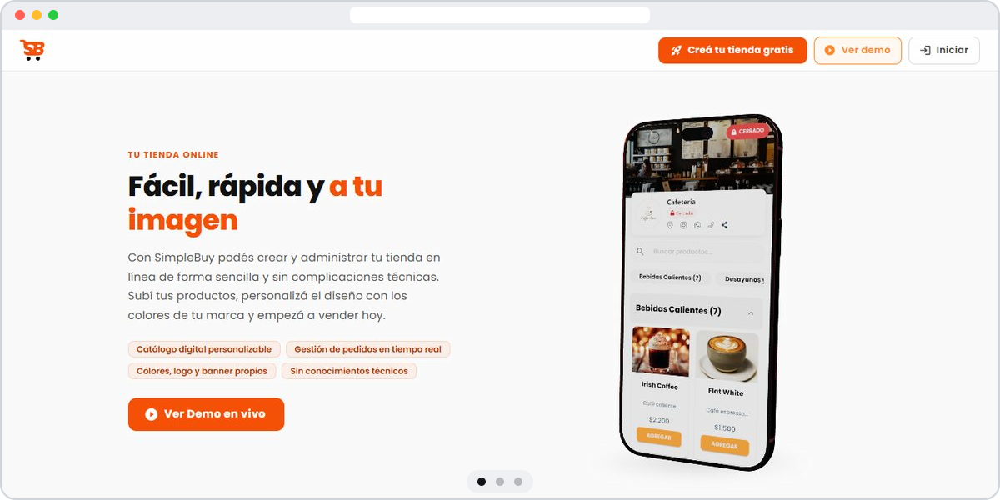</a>

  <picture><source media="(prefers-color-scheme: dark)" srcset="assets/card-club-dark.svg"></picture>
  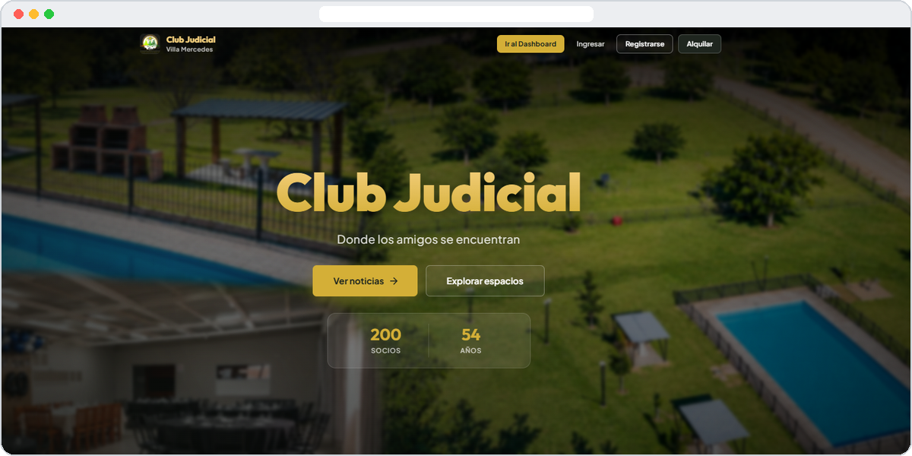

  <picture><source media="(prefers-color-scheme: dark)" srcset="assets/card-mamde-dark.svg"></picture>
  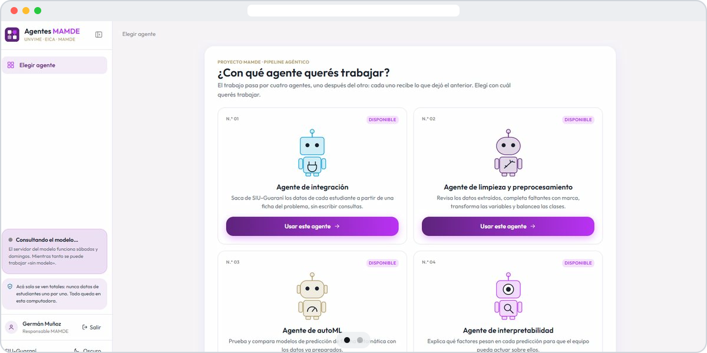

  <picture><source media="(prefers-color-scheme: dark)" srcset="assets/card-unvimecode-dark.svg"></picture>
  <picture><source media="(prefers-color-scheme: dark)" srcset="assets/capturas/unvimecode-carrusel-dark.svg">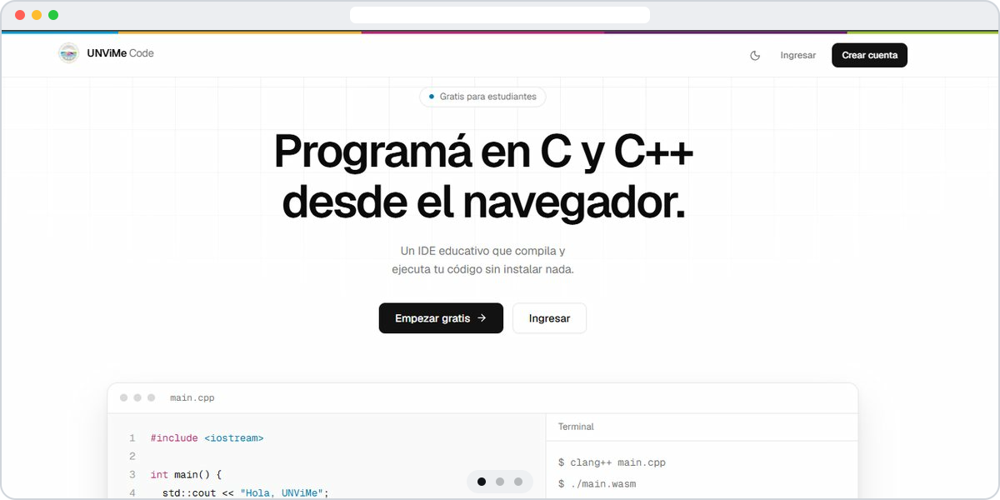</picture>

  <a href="https://github.com/yaguer11/asistencia-facial"><picture><source media="(prefers-color-scheme: dark)" srcset="assets/card-asistencia-dark.svg"></picture></a>
  <a href="https://github.com/yaguer11/asistencia-facial">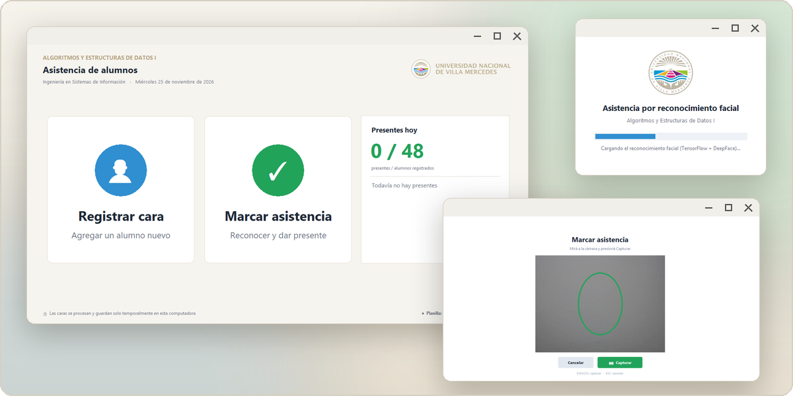</a>

  <a href="https://mi-economia-chi.vercel.app"><picture><source media="(prefers-color-scheme: dark)" srcset="assets/card-mieconomia-dark.svg"></picture></a>
  <a href="https://mi-economia-chi.vercel.app">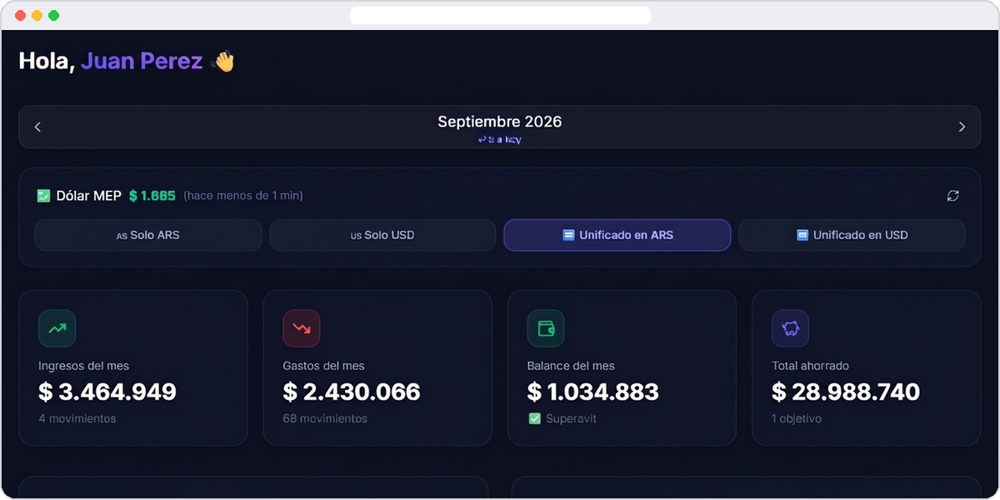</a>

  <a href="https://github.com/yaguer11/gestion-residuos"><picture><source media="(prefers-color-scheme: dark)" srcset="assets/card-residuos-dark.svg"></picture></a>
  <a href="https://github.com/yaguer11/gestion-residuos">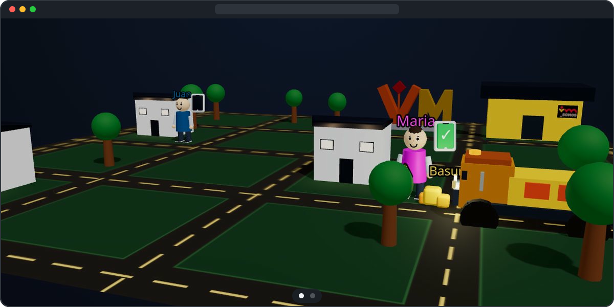</a>

  <a href="https://github.com/yaguer11?tab=repositories"><picture><source media="(prefers-color-scheme: dark)" srcset="assets/card-mas-dark.svg"></picture></a>

  <picture><source media="(prefers-color-scheme: dark)" srcset="assets/div-tecnologias-dark.svg"></picture>

  <picture><source media="(prefers-color-scheme: dark)" srcset="assets/tech-dark.svg"></picture>

  <picture><source media="(prefers-color-scheme: dark)" srcset="assets/div-contacto-dark.svg"></picture>

  <a href="https://www.linkedin.com/in/germ%C3%A1n-adri%C3%A1n-mu%C3%B1oz-97ab5122a/"><picture><source media="(prefers-color-scheme: dark)" srcset="assets/btn-linkedin-dark.svg"></picture></a>
  <a href="mailto:yaguer590@gmail.com"><picture><source media="(prefers-color-scheme: dark)" srcset="assets/btn-email-dark.svg"></picture></a>

Los proyectos con código privado son de equipos o clientes, puedo mostrarlos y explicarlos en una entrevista.

